<div align="center">

# 📸 Classroom Face Attendance

### Scan every student once. Snap the class. Attendance marks itself.

*A face-recognition attendance system that finds 50+ faces in a single classroom photo, matches each one to an enrolled student, and hands the teacher a clean review screen and an Excel sheet.*


[Features](#-features) · [The big picture](#-the-big-picture) · [Journey](#-the-teachers-day-in-one-picture) · [Under the hood](#-under-the-hood) · [Using the app](#-using-the-app) · [Deploy](#-deploy-to-google-cloud-run) · [Limits](#-honest-limitations) · [Licensing](#-model-licensing-read-this)

</div>

<!-- Add screenshots to docs/screenshots/ and uncomment:
<p align="center">
  
  
  
  
</p>
-->

---

## ✨ Why this exists

Calling out names in a class of 60 eats 5–10 minutes of every lecture. Paper registers get lost. Tap-to-mark apps still need a human to look at every face.

This project turns attendance into **one photo**:

| Old way | This way |
|---|---|
| 🗣 Roll call, 5–10 min | 📷 One or a few photos, ~seconds of teacher time |
| 📝 Paper register | 📊 Auto-built records sheet + Excel export |
| 🤷 Proxy attendance | 👀 Every face reviewed, uncertain ones flagged |
| 🧍 Teacher scans each student | 📱 Students scan themselves from a link |

---

## 🚀 Features

<table>
<tr>
<td width="50%" valign="top">

### 🎓 For teachers
- 📷 **Multi-photo sessions**: upload or capture several photos; each student is counted once
- ⏰ **Multi-hour classes**: present for the last 2 of 3 hours? Recorded exactly
- 🔍 **Review screen** with *confirmed*, *check* and *unknown* faces; reassign any face in a tap
- 🗂 **Records sheet** (students × dates), with editable past sessions
- 📥 **Excel export** with merged date headers, 1/0 cells, date-range filter and a "Classes held" sheet
- 🏫 **Multiple classes**, each with its own sensitivity (strict / balanced / lenient)
- ⚙️ **Class settings**: rename, download roster, reset scans, change password, delete class
- 📋 **Roster import** from Excel/CSV, or copy from another class

</td>
<td width="50%" valign="top">

### 🙋 For students
- 🔗 **Shareable scan link** that expires in 1 h, 5 h, 2 days or 5 days
- 🧭 **Guided 5-pose scan**: front, left, right, tilt up, tilt down
- ✅ **Live quality coaching**: face too small, too dark, blurry or turned the wrong way? It tells you
- 📱 Works from a normal phone browser, no app install
- 👯 **Duplicate warning** if a scan looks like another student

### 🧠 For the engine
- 🔬 **Tiled multi-scale detection** for tiny back-row faces
- 🤝 **Two-model ensemble** (ArcFace R50 + R100) for uncertain faces
- ♟ **One-to-one assignment**: two faces can't claim the same student
- 🌐 **Public read-only dashboard** to share results

</td>
</tr>
</table>

---

## 🗺 The big picture

Everything in the project, in one diagram:

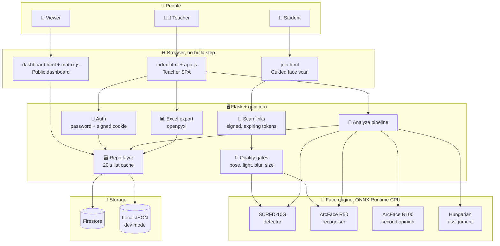

---

## 📅 The teacher's day in one picture

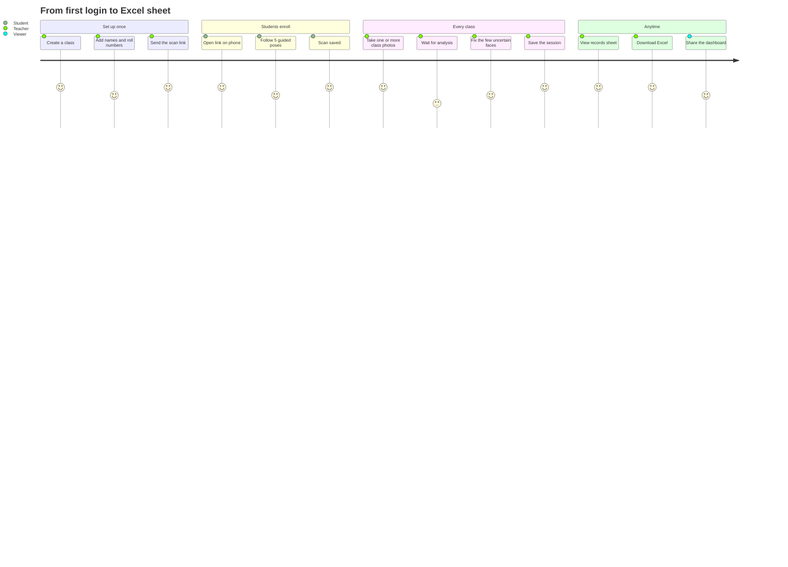

---

## 🔬 Under the hood

### 1️⃣ Enrollment: building a student's face profile

The server is stateless during a scan. The browser holds the progress, the server judges every frame.

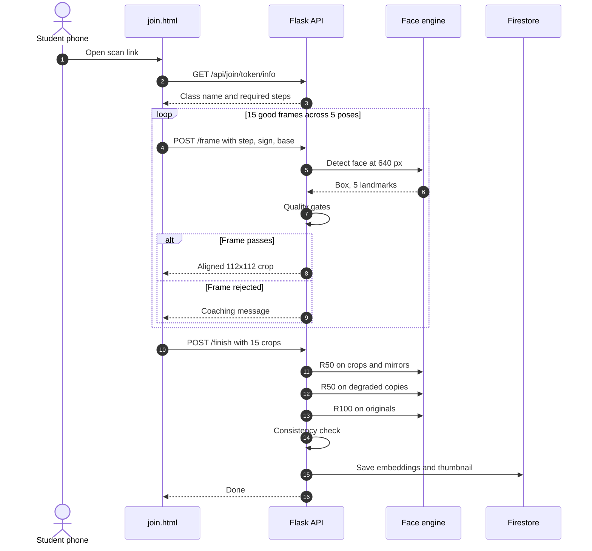

**The five poses and what each must satisfy**

| Step | Crops | Pose rule |
|---|---|---|
| 🙂 Front | 5 | \|yaw\| < 0.12, pitch becomes the student's baseline |
| ↩️ Side A | 3 | 0.20 < \|yaw\| ≤ 0.65 |
| ↪️ Side B | 3 | same range, opposite direction to Side A |
| ⬆️ Tilt A | 2 | \|Δpitch\| ≥ 0.08 vs baseline, \|yaw\| < 0.22 |
| ⬇️ Tilt B | 2 | opposite tilt to Tilt A |

**Quality gates applied to every frame**

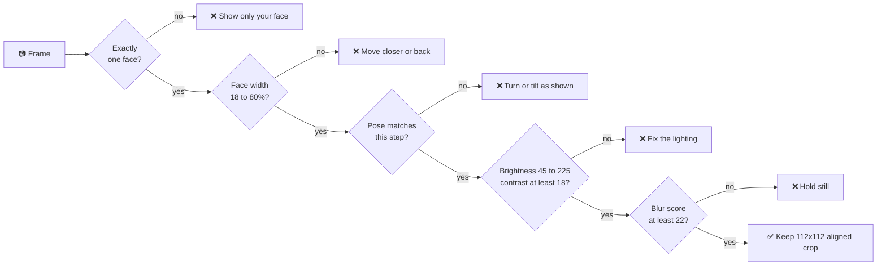

> **Pose maths.** Yaw = (nose_x − eye-midpoint_x) / eye distance. Pitch = (nose_y − eye_y) / (mouth_y − eye_y), compared with the person's own front-facing baseline so differently shaped faces are treated fairly.

**What gets stored per student** (so recognition survives real classroom conditions):

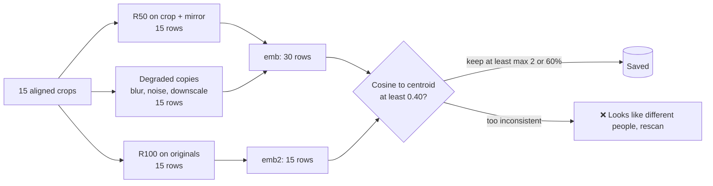

---

### 2️⃣ Finding every face in a crowded photo

Back-row faces can be only 10–30 pixels wide. A normal detector misses them, so `detect_group` looks at the photo several ways and merges the results.

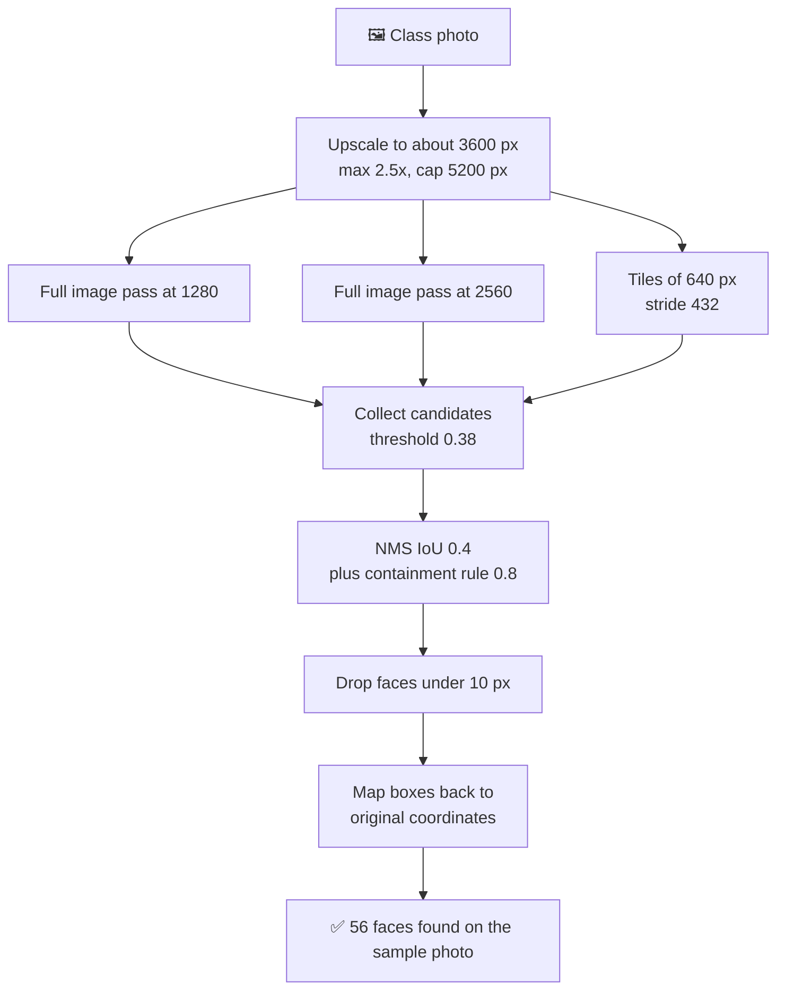

---

### 3️⃣ Matching faces to students

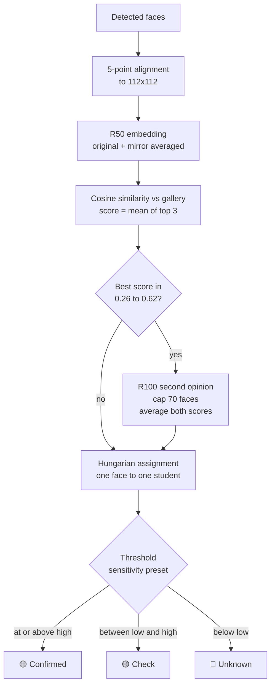

| Sensitivity | 🔴 Unknown below | 🟢 Confirmed at or above | Best for |
|---|---|---|---|
| Strict | 0.42 | 0.54 | Fewer false matches, more manual review |
| **Balanced** (default) | 0.36 | 0.48 | Most classrooms |
| Lenient | 0.30 | 0.42 | Hard lighting, accept more review of matches |

Anything between the two numbers lands in the 🟡 **check** pile for the teacher.

---

### 4️⃣ The attendance session lifecycle

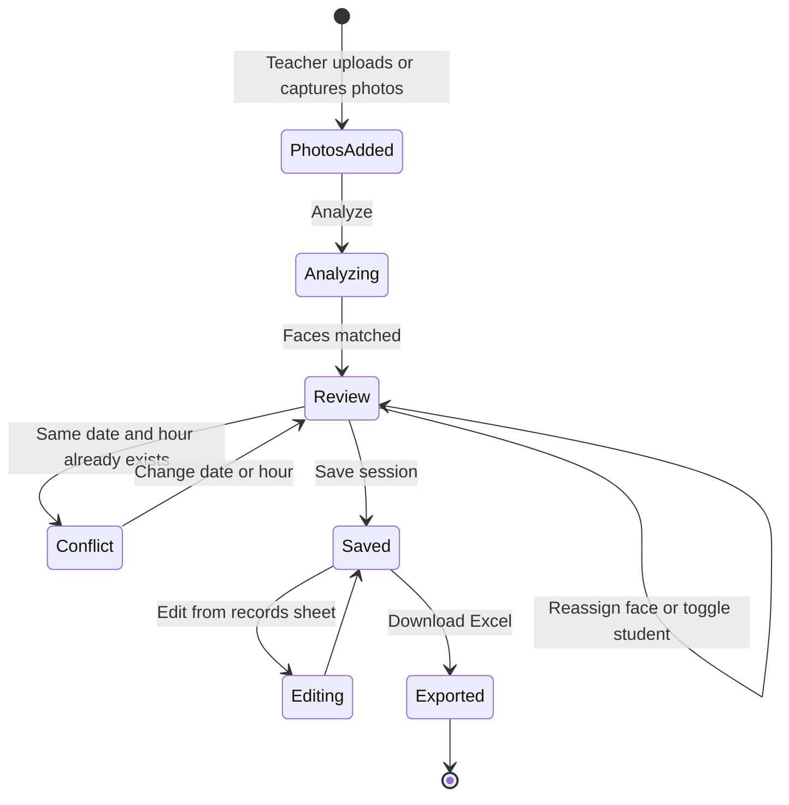

**Hours work like this:** `marks[student] = k` means the student attended the **last k** of the session's N sorted hour slots. A date + hour overlap returns HTTP 409.

---

### 5️⃣ How a face becomes a mark: end-to-end

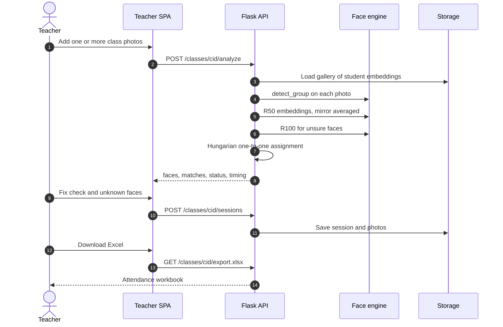

---

## 🧰 Tech stack

| Layer | Choice | Why |
|---|---|---|
| 🐍 Backend | Python 3.11, Flask, gunicorn (1 worker, 4 threads) | Simple, one process keeps the models in memory once |
| 👁 Detection | SCRFD-10G (`det_10g.onnx`, 17 MB) | Strong on small faces |
| 🧬 Recognition | ArcFace R50 (`w600k_r50.onnx`, 174 MB) and R100 Glint360K (`glintr100.onnx`, 260 MB) | Fast first pass, heavy second opinion |
| ⚡ Inference | ONNX Runtime, CPU | No GPU needed |
| 🖼 Imaging | OpenCV (headless), Pillow, NumPy | Alignment, resizing, quality checks |
| 🔢 Matching | SciPy (Hungarian), scikit-learn | One-to-one assignment |
| 💾 Storage | Firestore or local JSON | Same `Repo` interface for both |
| 🖥 Frontend | Vanilla JS SPA with hash routing | No bundler, no framework |
| 📊 Export | openpyxl | Merged headers, 1/0 grid |
| 🔐 Security | Admin password, signed cookie, `itsdangerous` timed tokens | Scan links expire on their own |
| ☁️ Hosting | Google Cloud Run (Cloud Build from `Dockerfile`), optional Firebase Hosting rewrite | Scales to zero |

---

## 📖 Using the app

The app is hosted on **Google Cloud Run**, so teachers and students just open its web address. Nothing to install.

> 🌐 **Live app:** `https://YOUR-SERVICE-URL.run.app` *(replace with your Cloud Run URL)*

### Who sees what

| Role | How they get in | What they can do |
|---|---|---|
| 👩‍🏫 **Admin (teacher)** | Opens the site and signs in with the admin password | Everything: attendance, records, students, class settings |
| 🙋 **Student** | A temporary scan link from the teacher | Only the face scan |
| 👀 **Anyone** | The public dashboard link | Read-only attendance view, no login |

### Pages

| Path | Purpose |
|---|---|
| `/` | Admin app: **Attendance** (home), **Records**, **Students**. Class switcher and Share button at the top. |
| `/join/<token>` | Student face scan. Temporary link, valid from 1 hour to 5 days. |
| `/dashboard` | Public attendance dashboard. Never expires, no login. |

### Taking attendance

1. **Pick the date and hour(s).** The current hour is pre-selected; tap several for 2- or 3-hour classes.
2. **Add photos** with *Take photo* (phone camera) or *Upload photos*. Add as many as you like; faces from all photos are combined, and one photo at a time gives the sharpest faces.
3. **Review the list.** Each student shows 0..N hours attended. Tap a lower number for a late student, and fix any 🟡 *check* or 🔴 *unknown* faces.
4. **Save attendance.** Nothing is stored until you press Save.

Each saved class becomes one row under **Records → Classes taken**. Open it to see the photos, add students back or change hours.

### Excel export

**Records → Export to Excel** (optionally for a date range). There is one column per class hour: `1` = attended, `0` = missed, with dates merged across their hours. A student marked 2 of 3 hours counts as late: `0` for the first hour, `1` for the last two.

### Students and classes

- **Add students** by pasting two columns from Excel (Name, Roll no.), uploading `.xlsx` / `.csv`, or adding one at a time. Edit any name or roll number in place.
- **New class:** optionally copy students (and their face scans) from another class. The copy is independent.
- **Get scans:** use *Share* to create a scan link and send it to students, or add photos for a student from the Students tab.
- **Class settings (⚙):** rename or delete the class, set matching strictness (strict / balanced / lenient), reset scans, change the admin password, import old scans.

---

## ☁️ Deploy to Google Cloud Run

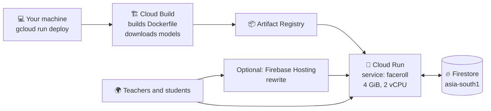

```bash
gcloud config set project YOUR_PROJECT_ID
gcloud services enable run.googleapis.com cloudbuild.googleapis.com \
    artifactregistry.googleapis.com firestore.googleapis.com
gcloud firestore databases create --location=asia-south1   # once

gcloud run deploy faceroll --source . --region asia-south1 \
  --memory 4Gi --cpu 2 --timeout 300 --cpu-boost \
  --max-instances 2 --concurrency 4 --allow-unauthenticated \
  --set-env-vars ADMIN_PASSWORD=your-password,SECRET_KEY=$(openssl rand -hex 32)
```

**Checklist**

- 🧠 **Memory:** at least **4 GiB**; both recognisers plus the detector live in RAM
- 🔑 **IAM:** the Cloud Run service account needs `roles/datastore.user` to use Firestore
- 🔄 **Update:** re-run `gcloud run deploy faceroll --source . --region asia-south1 --memory 4Gi --cpu 2 --timeout 300`; env vars are kept
- 🍪 **Cookie name:** `__session`, the only cookie Firebase Hosting forwards
- 📘 More detail in [`DEPLOY.md`](DEPLOY.md), including recovering scans saved by an older version

Free-tier and trial terms change; check Google's current pricing before assuming anything is free.

---

## ⚙️ Configuration

| Variable | What it does | Default |
|---|---|---|
| `ADMIN_PASSWORD` | Admin login. A password changed inside the app (stored hashed in `settings/admin`) overrides it. Neither set means no login. | unset |
| `SECRET_KEY` | Signs cookies and scan links. Rotating it kills every existing scan link. | random per run, so set it in production |
| `STORE` | `local` or `firestore` | `local` (`firestore` in Docker) |
| `ATT_DATA` | Folder for local JSON data | `data/` |
| `PORT`, `HOST` | Bind address | `8000`, `0.0.0.0` |
| `K_SERVICE` | Set by Cloud Run; makes the cookie `Secure` | n/a |

---

## 💻 Run locally (optional, for development)

You do not need this to use the app. It is only for developing or testing changes on your own machine.

```bash
git clone https://github.com/<you>/<repo>.git
cd <repo>
bash run.sh          # sets up a venv, downloads models, starts the server
```

Then open `http://localhost:8000`. Data is stored in `data/` as local JSON, and there is no login unless you set `ADMIN_PASSWORD`. The phone camera only works over HTTPS, so test the student scan page on the deployed Cloud Run URL.

---

## 🗃 Data model

```mermaid
erDiagram
    CLASS ||--o{ STUDENT : has
    CLASS ||--o{ SESSION : records
    CLASS ||--o{ PHOTO : stores
    SESSION }o--o{ PHOTO : uses
    SESSION ||--o{ MARK : contains
    STUDENT ||--o{ MARK : earns

    CLASS {
        string id
        string name
        string sens
        timestamp created
    }
    STUDENT {
        string id
        string name
        string roll
        int order
        array emb "R50 rows"
        array emb2 "R100 rows"
        blob thumb "front crop JPEG"
        timestamp scanned_at
    }
    SESSION {
        string id
        string date
        array slots "hours"
        timestamp created
        timestamp updated
    }
    MARK {
        string student_id
        int hours_attended "last k of N slots"
    }
    PHOTO {
        string id
        blob data "JPEG up to about 850 KB"
        int w
        int h
        array faces "bbox, sid, sim, status"
    }
```

Plus one global document, `settings/admin`, holding the password hash.

---

## 🔌 API at a glance

~40 routes. Everything under `/api` needs the admin session, except login, health, public and join endpoints.

| Area | Endpoints |
|---|---|
| 🔐 Auth | `POST /api/login` · `POST /api/logout` · `GET /api/me` · `POST /api/password` |
| 🏫 Classes | `GET/POST /api/classes` · `PATCH/DELETE /api/classes/<cid>` · `POST …/clear-faces` · `POST …/clear-students` · `POST …/copy-from` |
| 🎓 Students | `GET/POST …/students` · `PATCH/DELETE …/students/<sid>` · `POST …/students/parse-file` · `GET /api/students-template.xlsx` · `GET …/students.xlsx` · `POST …/students/<sid>/face-photos` · `POST …/students/<sid>/clear-face` |
| 📸 Attendance | `POST …/analyze` · `GET/POST …/sessions` · `GET/DELETE …/sessions/<id>` · `GET …/photos/<pid>.jpg` · `GET …/matrix` · `GET …/export.xlsx` |
| 🔗 Scan links | `POST /api/invite` · `GET /join/<token>` · `GET /api/join/<token>/info` · `POST …/frame` · `POST …/finish` |
| 🌐 Public | `GET /api/public/classes` · `GET /api/public/classes/<cid>/matrix` |
| 🛟 Migration | `GET /api/legacy` · `POST /api/classes/<cid>/legacy-import` |
| ❤️ Ops | `GET /healthz` |

---

## 📁 Project structure

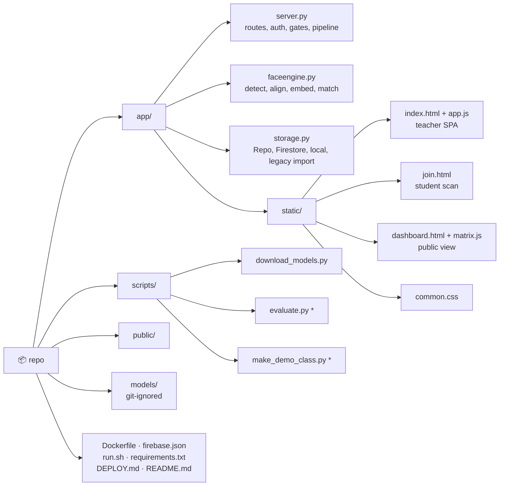

<sub>\* Optional developer helpers that expect a local `demo/` folder. The server does not use them.</sub>

---

## 🎯 Getting the best accuracy

1. 📸 **Photo quality beats settings.** Aim for faces at least ~30 px wide, front-lit, no motion blur. The app warns when an upload's long side is under 2400 px.
2. 🔁 **Take 2–3 photos** from different angles; a face missed in one is usually caught in another.
3. 🎚 **Pick the right sensitivity** per class (Settings → Sensitivity).
4. 🧑‍🏫 **Re-scan** students who keep showing up as *check* or *unknown*, ideally in similar lighting to the classroom.
5. 🔧 Constants for scales, tile stride, thresholds and the R100 band sit near the top of `faceengine.py` and `server.py`.

---

## ⏱ Performance

Measured on a 2-CPU sandbox, CPU only:

| Task | Time |
|---|---|
| Class photo with ~56 faces (full tiled detection + ensemble) | **about 40 s** |
| Model loading on startup | about 15 s |

Cloud Run timings have not been benchmarked and will vary with CPU allocation. Use a minimum instance count if cold starts matter. The project deliberately trades speed for accuracy.

---

## ⚠️ Honest limitations

- **Not benchmarked at scale.** Tested on sample photos, not a large labelled classroom dataset. Always keep the review step.
- **No liveness check.** A printed photo or a screen can pass during enrollment.
- **Scan links can't be revoked one by one.** They expire; rotate `SECRET_KEY` to kill all.
- **Public dashboard lists all classes.** It is for convenience, not confidentiality.
- **One analysis at a time.** A long class analysis blocks other face work on the same worker.
- **Real Firestore not end-to-end tested here.** Verified against a fake/local backend; test on your own project.
- **Scan thresholds are untested on real phones.** Side-turn and tilt limits in `frame_impl` may need adjusting.
- Tiny, blurred, masked or heavily occluded faces will be missed or mismatched.

---

## 🔒 Privacy and consent

Face images and embeddings are **biometric, sensitive personal data**.

- ✍️ Get informed consent from students (and guardians for minors) before enrolling
- ⚖️ Check applicable law (GDPR, India's DPDP Act, local education and child-protection rules)
- 🗄 Stored data: face embeddings, one small thumbnail per student, and the class photos you upload
- 🧹 Delete via *reset all scans*, *delete student*, *delete session*, *delete class*
- 🔑 Set a strong `ADMIN_PASSWORD` and `SECRET_KEY` on any public deployment

---

## 📜 Model licensing: read this

The **code** in this repo is MIT. The **model weights are not.**

- SCRFD and ArcFace models come from the [InsightFace](https://github.com/deepinsight/insightface) packs `buffalo_l` and `antelopev2`. InsightFace states its pretrained models are **for non-commercial research use only**; commercial use needs a licence from the InsightFace team (contact@insightface.ai).
- Planning to sell or commercially deploy this? Get commercial rights or swap in models whose licence fits.
- Models are never committed; `scripts/download_models.py` fetches them.

---

## 🛣 Roadmap

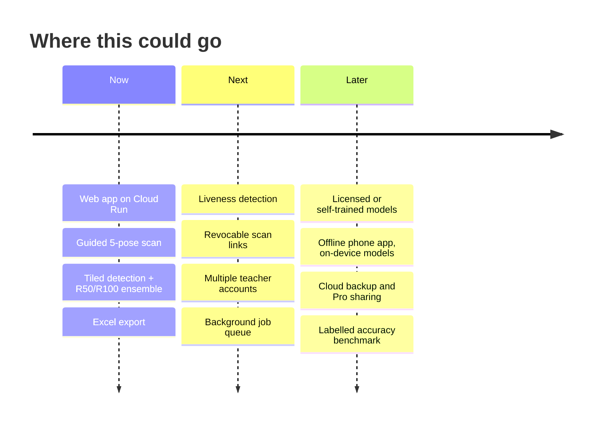

---

## 🤝 Contributing

1. Fork and branch
2. Run locally with `bash run.sh` and try your change on a few real photos
3. Keep PRs focused; say what changed and how you tested it
4. **Never commit** model files, student photos or personal data

---

## 📄 License

Code: [MIT](LICENSE) (add a `LICENSE` file with your name and year). Model weights: their own licences, see [above](#-model-licensing-read-this).

## 🙏 Acknowledgements

[InsightFace](https://github.com/deepinsight/insightface) · [ONNX Runtime](https://onnxruntime.ai/) · [OpenCV](https://opencv.org/) · [NumPy](https://numpy.org/) · [SciPy](https://scipy.org/) · [Flask](https://flask.palletsprojects.com/) · [openpyxl](https://openpyxl.readthedocs.io/) · Google Cloud Run and Firestore

<div align="center">

**If this saved you a roll call, drop a ⭐**

</div>
